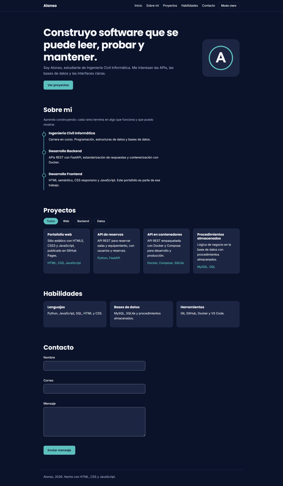

# Portafolio Alonso (React + TypeScript)
Autor: Alonso Lantaño · Desarrollo de Frontend (ICINF1107)

Migración a React del portafolio de la Evaluación 2. Proyecto Integrado Final, ICINF1107.

## Ejecutar
```bash
npm install
npm run dev      # servidor de desarrollo
npm run build    # compila y revisa los tipos
```

## Tecnologías
React, TypeScript (sin `any`), Vite y React Router.

## Estructura
- `src/pages`: una página por ruta (Inicio, Sobre mí, Proyectos, Habilidades, Contacto y 404).
- `src/components`: piezas reutilizables (Layout, Navbar, Seccion, tarjetas, filtro, campo de formulario).
- `src/data`: contenido del portafolio, fuera del JSX.
- `src/hooks`: lógica reutilizable (tema, título de página, filtro, repositorios).
- `src/services`: acceso a la API.
- `src/config`: rutas y enlaces del menú.
- `src/types`: tipos e interfaces exportados.

## Rutas
`/`, `/sobre-mi`, `/proyectos`, `/habilidades`, `/contacto`. La navegación marca la sección activa, el logo lleva siempre al inicio y cualquier otra dirección muestra una página 404 con enlace de regreso.

## Fidelidad al diseño de la E2
Captura del portafolio original de la E2, con la que se compara este proyecto:



Se conservaron las cinco secciones, la jerarquía, las tipografías (Poppins e Inter), los fondos azul marino, el modo claro/oscuro, el filtro de proyectos y el formulario con validación.

Decisiones de mejora:
- Se añadieron animaciones de entrada y efectos hover para dar más interactividad. Respetan `prefers-reduced-motion`.
- La navegación pasó de anclas a rutas, por el requisito de React Router.
- Se añadió una sección de repositorios (API).

## API consumida
- Endpoint: `GET https://api.github.com/users/AlonsolfDev/repos?sort=updated&per_page=6`
- Respuesta usada: lista de objetos con `id`, `name`, `description`, `html_url`, `language` y `stargazers_count` (tipo `RepoGitHub`).
- Elegí este endpoint porque es público, no necesita clave y encaja con un portafolio: los proyectos se muestran con datos reales.
- Estados: carga (esqueleto), error (mensaje con botón de reintento) y datos. El resultado se guarda en caché para no repetir la petición, y se evitan condiciones de carrera con una bandera en `useEffect`.
- Límite: 60 peticiones por hora por IP sin autenticación.